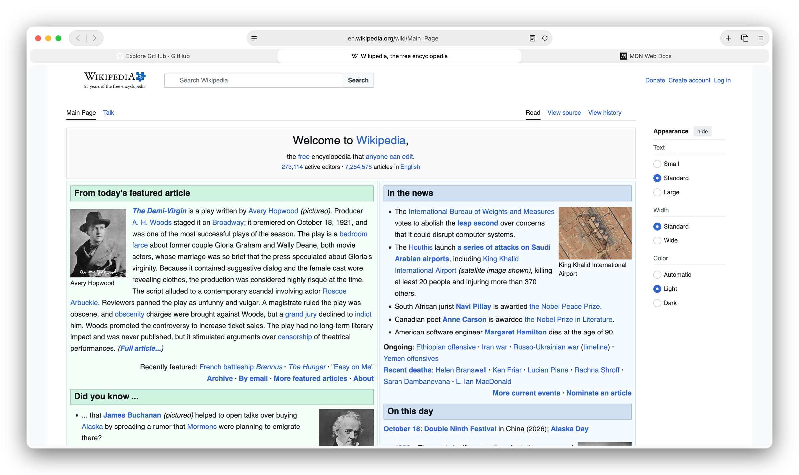
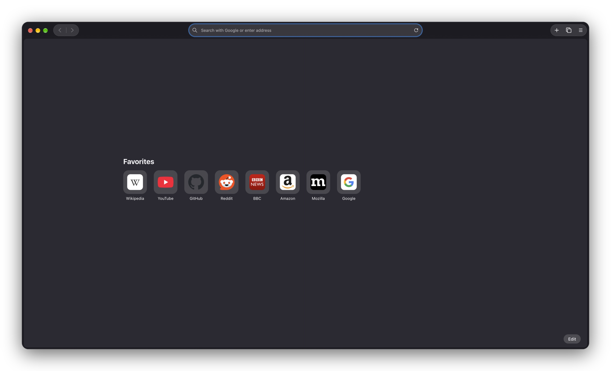
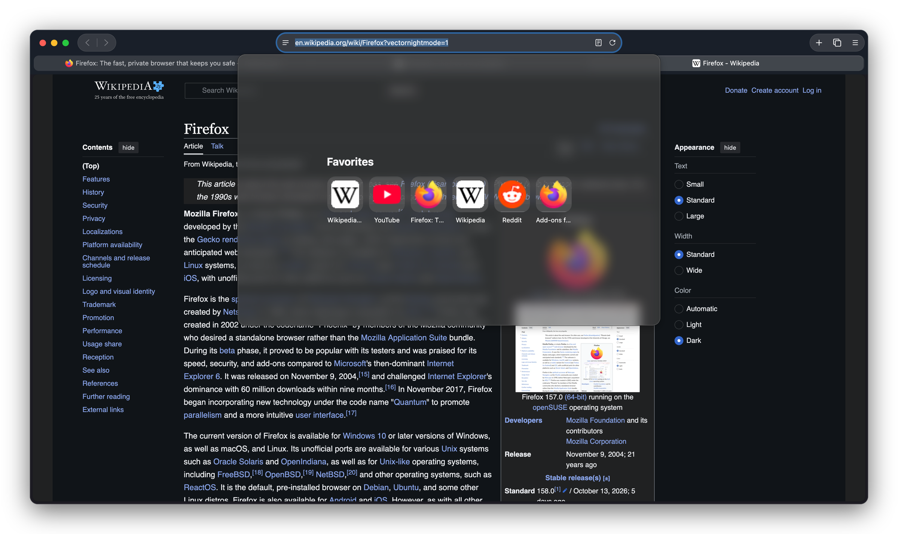

# Tahoefox

<p align="center">
<picture>
<source media="(prefers-color-scheme: dark)" srcset="docs/preview-dark.png">
<source media="(prefers-color-scheme: light)" srcset="docs/preview.png">

</picture>
</p>

A Firefox theme that copies the look and feel of Safari on macOS Tahoe: a centered address bar, glass capsules for the toolbar buttons, a full-width tab row with centered titles, a Favorites grid on the new tab page and in the address bar, and a neutral toolbar that can take on each site's colour.

> [!NOTE]
> Tahoefox is tuned for macOS 26 Tahoe and later and tested on Firefox 158 on macOS 27 with horizontal tabs. Windows and Linux get [gwfox's](https://github.com/akkva/gwfox) styling, but the Safari layout has not been checked there.

## Installation

### With the script (macOS and Linux)

Quit Firefox, then run from the project folder:

```bash
./install.sh
```

The script finds your default profile, backs up its `chrome` folder the first time, copies the theme in and writes the three preferences Tahoefox needs to its own block in `user.js`. Other files in `chrome`, other lines in `user.js` and your `about:config` settings are left alone. If you used gwfox before, your `gwfox.*` switches are carried over once as `tahoefox.*` in `about:config`, so you can still change them there.

| Option | What it does |
| :--- | :--- |
| `--profile PATH` | Use another profile (see `about:profiles` for the paths) |
| `--link` | Link the CSS instead of copying it, so edits in this folder show up after a Firefox restart. `userContent.css` gets a hard link, because Firefox's content sandbox will not follow a symlink out of the profile; if git replaces that file, run `--link` again |
| `--uninstall` | Remove the theme, restore the original `chrome` folder and drop the preferences from `user.js` |
| `--no-migrate` | Do not carry over `gwfox.*` switches |
| `--dry-run` | Print what would happen without touching anything |
| `--force` | Run even if Firefox looks open |

### By hand (any platform)

1. Copy `userChrome.css` and `userContent.css` into the `chrome` folder of your profile (create it if needed; `about:support` → Profile Folder shows where the profile lives).
2. Set these in `about:config`:

| Preference | Value | Platform / Notes |
| :--- | :--- | :--- |
| `toolkit.legacyUserProfileCustomizations.stylesheets` | true | Required |
| `svg.context-properties.content.enabled` | true | Required |
| `widget.macos.native-context-menus` | false | macOS |
| `widget.windows.mica` | true | Windows |
| `widget.windows.mica.toplevel-backdrop` | 2 | Windows |
| `widget.gtk.rounded-bottom-corners.enabled` | true | Linux |

3. Restart Firefox.

> [!IMPORTANT]
> For East Asian (CJK) input, enable "Address Bar: show results during IME composition" in Settings → Firefox Labs.

<p align="center">


</p>

Favorites are the shortcuts you pin: right-click a tile and choose Pin, or add one with the + tile. Sites Firefox picks from your history go under Frequently Visited, below them.

## Customization

### Tahoefox switches

Create these as boolean preferences in `about:config` and set them to `true`. They take effect immediately, no restart needed.

| Preference | What it changes |
| :--- | :--- |
| `tahoefox.tabs.always` | Keep the tab row visible when only one tab is open |
| `tahoefox.tabs.close-right` | Put the tab close button on the right instead of the left |
| `tahoefox.tabs.wide-active` | Let the active tab grow wider than the others, like stock Firefox |
| `tahoefox.toolbar.extensions` | Show the Extensions button |
| `tahoefox.toolbar.sidebar` | Show the sidebar button |
| `tahoefox.toolbar.tint` | Keep gwfox's tinted, translucent toolbar instead of the neutral Safari grey |
| `tahoefox.urlbar.star` | Show the bookmark star in the address bar |
| `tahoefox.urlbar.list` | Show a plain list in the empty address bar instead of the Favorites grid |
| `tahoefox.bookmarks.placeholder` | Show the bookmarks toolbar even while it is empty |
| `tahoefox.newtab.stock` | Keep Firefox's own new tab page |
| `tahoefox.newtab.search` | Show the search box on the new tab page |

### Sizes and colours

The top of the Tahoefox section in `userChrome.css` has a small block of variables:

```css
:root {
  --tahoefox-toolbar-color: light-dark(#efeeed, #302e2d);
  --tahoefox-tabbar-color: light-dark(rgba(0, 0, 0, .08), rgba(170, 170, 170, .2));
  --tahoefox-tab-selected-color: light-dark(#fff, rgba(170, 170, 170, .1));
  --tahoefox-tab-selected-shadow: 0 1px 3px light-dark(rgba(0, 0, 0, .18), rgba(0, 0, 0, .3)), 0 0 0 .5px light-dark(rgba(0, 0, 0, .1), transparent), inset 0 0 0 .5px light-dark(transparent, rgba(255, 255, 255, .1)), inset 0 1px 0 light-dark(transparent, rgba(255, 255, 255, .12));
  --tahoefox-urlbar-max-width: 710px;
  --tahoefox-urlbar-width: 41vw;
  --tahoefox-tab-height: 31px;
  --tahoefox-tab-radius: 10px;
  --tahoefox-dropdown-radius: 16px;
  --tahoefox-toolbar-inset: 8px;
}
```

Change the values and restart Firefox.

### Site colours

Install [Adaptive Tab Bar Colour](https://addons.mozilla.org/firefox/addon/adaptive-tab-bar-colour/) and set `tahoefox.atbc` to `true`; the toolbar then takes on the colour of the page you are on, as Safari does. In the add-on's settings (`about:addons` → Adaptive Tab Bar Colour → Settings), set the brightness adjustments for the tab bar and background to 0 to get the page colour exactly.

### More switches (from gwfox)

| Preference | Description | Notes |
| :--- | :--- | :--- |
| `tahoefox.urlbar` | Move address bar to sidebar | Vertical tabs; not for hover-expand mode |
| `tahoefox.toolbar` | Auto-hide bookmarks toolbar | |
| `tahoefox.blur` | Add acrylic effect to floating panels | |
| `tahoefox.ac` | Enable accent colour | Edit `--bg0` in the CSS to customize |
| `tahoefox.atbc` | Adaptive Tab Bar Colour compatibility | See above |
| `tahoefox.newtab` | New tab transparency | Requires `allow_transparent_browser` |
| `tahoefox.noborder` | Remove window borders | |
| `tahoefox.bms` | Main window transparency | Linux |
| `tahoefox.icons` | Add menu icons | |
| `tahoefox.mwc` | macOS-style window controls | Windows/Linux |
| `tahoefox.msc` | macOS-style tab close button | |
| `tahoefox.twc` | Theme-styled window controls | Windows/Linux |
| `tahoefox.twc.ac` | Auto-collapse window controls | |
| `tahoefox.fxa` | Replace app menu icon with avatar | Requires sign-in |
| `tahoefox.fsi` | [FluentUI System Icons](https://github.com/microsoft/fluentui-system-icons) | |

| Preference (number) | Description | Values |
| :--- | :--- | :--- |
| `tahoefox.sidebar` | Sidebar width | `1` narrow, `3` wide, anything else default |
